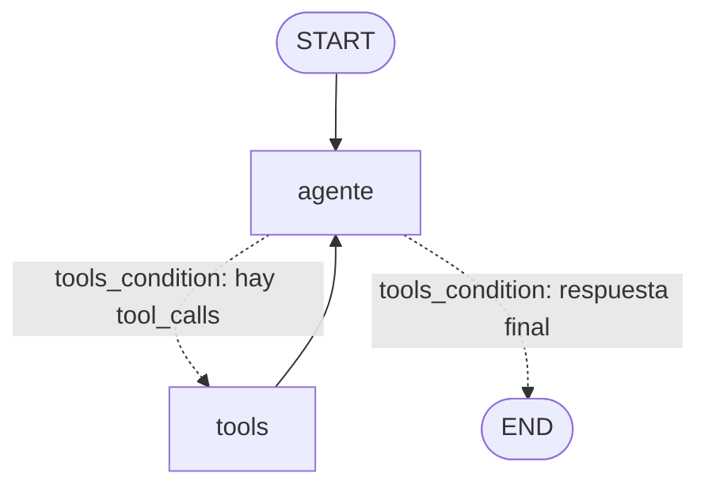

# Pre-entrega 5: Agente de razonamiento cíclico con memoria persistente

Agente **ReAct** construido con **LangGraph** para **GenPet**, una empresa (ficticia) que vende paños higiénicos
para mascotas de **60x90 cm** en dos presentaciones: **pack x20** y **pack x50**.

El agente responde consultas del equipo combinando dos fuentes:

- **Sistema de pedidos** (SQLite simulado): clientes, pedidos e ítems, a través de 4 tools con `@tool`.
- **Base de conocimiento** (RAG híbrido Pinecone + BM25): historial de ventas, ganancias, plan comercial,
  políticas, ficha técnica y datos de la empresa.

El razonamiento es cíclico (`agente → tools → agente …`) y la memoria persiste en SQLite por `thread_id`.
La consigna original está en [`CONSIGNA.md`](CONSIGNA.md) y la teoría del módulo en [`teoria/`](teoria/).

## Arquitectura del grafo



| Pieza | Implementación | Archivo |
|---|---|---|
| Estado | `AgentState(MessagesState)`: `messages` con reducer `add_messages` | [`agent/state.py`](agent/state.py) |
| Nodo del modelo (Reason) | LLM con `bind_tools()` + recorte del historial (`trim_messages`) | [`agent/nodes.py`](agent/nodes.py) |
| Nodo de herramientas (Act) | `ToolNode(tools, handle_tool_errors=True)` | [`agent/graph.py`](agent/graph.py) |
| Arista condicional | `tools_condition`: va a `tools` si hay `tool_calls`, si no a `END` | [`agent/graph.py`](agent/graph.py) |
| Observación | Arista `tools → agente`: el resultado vuelve al LLM (cierra el ciclo) | [`agent/graph.py`](agent/graph.py) |
| Persistencia | `AsyncSqliteSaver` en `checkpoints.sqlite`, indexado por `thread_id` | [`agent/checkpointer.py`](agent/checkpointer.py) |
| Techo de pasos | `recursion_limit=30` (`RECURSION_LIMIT` en `config.py`) en cada invocación | [`agent/session.py`](agent/session.py) |

## Herramientas

| Tool | Fuente | Qué hace |
|---|---|---|
| `buscar_cliente(nombre)` | SQLite | Busca por nombre parcial. Si no hay coincidencias devuelve `error` + `sugerencias` + `accion_sugerida` |
| `consultar_pedidos_cliente(cliente_id, estado?, desde?, hasta?)` | SQLite | Cantidad de pedidos, total facturado y lista de pedidos (más reciente primero) |
| `detalle_pedido(pedido_id)` | SQLite | Productos, cantidades, precios, descuento y total de un pedido |
| `listar_productos()` | SQLite | Catálogo con precio de lista vigente y stock |
| `buscar_informacion_empresa(consulta)` | RAG | Fragmentos relevantes de los documentos internos, con su fuente |

Cada tool con argumentos tiene un `args_schema` de **Pydantic** ([`schemas.py`](schemas.py)): los tipos se validan
antes de tocar la base de datos.

## Estructura

```text
5- Entrega/
├── README.md                    # Este archivo
├── CONSIGNA.md                  # Consigna original de la pre-entrega
├── CLAUDE.md                    # Mejores prácticas de LangGraph aplicadas en el proyecto
├── requirements.txt             # Dependencias (versiones fijadas)
├── .env.example                 # Plantilla de variables de entorno (copiar a .env)
├── pytest.ini                   # Config de tests (asyncio_mode=auto)
│
├── config.py                    # Punto único de configuración: rutas, límites y settings desde .env
├── schemas.py                   # Modelos Pydantic: entidades, contratos de las tools y metadata del RAG
├── formatting.py                # Formato de montos en pesos ($1.234.567)
│
├── generate_mock_data.py        # Script: genera los datos mock (data/seed) y los reportes de ventas/ganancias
├── setup_db.py                  # Script: crea data/genpet.db desde data/seed (python setup_db.py [--force])
├── ingest.py                    # Script: indexa data/docs en Pinecone (python ingest.py [--force])
├── main.py                      # Script: chat con el agente; guarda la traza en traces/<thread_id>.json/.log
│
├── agent/                       # El grafo ReAct
│   ├── state.py                 # AgentState(MessagesState)
│   ├── prompts.py               # System prompt (reglas de uso de tools, reintentos y aclaraciones)
│   ├── llm.py                   # Factory del chat model según LLM_PROVIDER
│   ├── nodes.py                 # Nodo "agente": invoca al LLM con el historial recortado
│   ├── graph.py                 # StateGraph: agente + ToolNode + tools_condition
│   ├── checkpointer.py          # AsyncSqliteSaver (persistencia por thread_id)
│   ├── session.py               # create_agent() y run_turn() (con recursion_limit)
│   └── trace.py                 # TraceRecorder: traza ReAct en .log y .json
│
├── tools/                       # Contrato de herramientas (@tool + docstrings descriptivos)
│   ├── __init__.py              # build_tools(): arma la lista de tools inyectando dependencias
│   ├── pedidos.py               # buscar_cliente, consultar_pedidos_cliente, detalle_pedido, listar_productos
│   └── conocimiento.py          # buscar_informacion_empresa (RAG, inicialización perezosa)
│
├── db/                          # Base de pedidos (SQLite)
│   ├── database.py              # Esquema + carga desde el seed
│   └── repository.py            # Consultas async (aiosqlite), conexión de solo lectura
│
├── rag/                         # RAG híbrido, adaptado de la Pre-entrega 4
│   ├── embeddings.py            # Embeddings OpenAI o Gemini a 1536 dims
│   ├── pinecone_index.py        # ensure_index(): crea/valida el índice Serverless
│   ├── loaders.py               # Carga los .md con categoría y tags del catálogo
│   ├── splitter.py              # Chunking por tokens respetando secciones Markdown + ids determinísticos
│   ├── ingestion.py             # load → split → embed → upsert en el namespace
│   └── retriever.py             # RAGSystem: EnsembleRetriever(BM25 + Pinecone)
│
├── data/
│   ├── catalog.json             # Categoría y tags de cada documento del RAG
│   ├── seed/                    # productos.json, clientes.json, pedidos.json (generados, no se versionan)
│   └── docs/                    # Corpus del RAG: 6 documentos internos de GenPet
│
├── traces/
│   ├── traza-react.log          # Traza legible de la prueba de ejecución (thread_id=traza-react)
│   └── traza-react.json         # La misma traza, estructurada (tool calls, args, observaciones)
│
├── tests/                       # 17 tests: tools, ciclo del grafo, persistencia y recursion_limit
├── teoria/                      # Material teórico del módulo (LangGraph, Tool Calling, ReAct)
└── Ejercicios/                  # Ejercicios de práctica de LangGraph (soporte y reflexión)
```

Archivos generados localmente que no se suben (ver `.gitignore`): `.env`, `data/seed/`, `data/genpet.db` y
`checkpoints.sqlite`.

## Cómo levantar el entorno

1. **Crear el entorno virtual e instalar dependencias** (Python 3.12+):

   ```bash
   python -m venv venv
   # Windows
   venv\Scripts\activate
   # Linux / macOS
   source venv/bin/activate

   pip install -r requirements.txt
   ```

2. **Configurar variables de entorno:** copiar `.env.example` a `.env` y completar:

   | Variable | Descripción |
   |---|---|
   | `LLM_PROVIDER` | `openai`, `anthropic`, `gemini` u `openrouter` |
   | `LLM_MODEL` | Opcional: pisa el modelo por defecto (`gpt-4o-mini`, `claude-haiku-4-5`, `gemini-2.5-flash`, `openai/gpt-4o-mini`) |
   | `OPENAI_API_KEY` / `ANTHROPIC_API_KEY` / `GEMINI_API_KEY` / `OPENROUTER_API_KEY` | Key del provider elegido |
   | `EMBEDDING_PROVIDER` | `gemini` u `openai` (embeddings del RAG) |
   | `PINECONE_API_KEY` | API key de Pinecone |
   | `INDEX_NAME` | Índice de Pinecone (dim 1536; se crea si no existe) |
   | `PINECONE_NAMESPACE` | Namespace del corpus de GenPet (default `genpet-docs`) |
   | `PINECONE_CLOUD` / `PINECONE_REGION` | Ubicación del índice Serverless (`aws` / `us-east-1`) |

3. **Generar los datos mock y crear la base de pedidos:**

   ```bash
   python generate_mock_data.py   # crea data/seed/*.json (no se versiona) y los reportes de data/docs
   python setup_db.py             # crea data/genpet.db a partir de data/seed
   ```

   La semilla es fija: los datos generados son siempre los mismos (y coinciden con la traza incluida).

4. **Indexar la base de conocimiento en Pinecone:**

   ```bash
   python ingest.py
   ```

5. **Usar el agente** (la sesión se recuerda entre ejecuciones con el mismo `--thread`):

   ```bash
   python main.py --thread ventas-octubre                                   # chat interactivo
   python main.py --thread ventas-octubre "¿Cuántos pedidos tuvo Patitas Felices?"
   python main.py --thread ventas-octubre "¿Y cuál fue su último pedido?"   # recuerda el turno anterior
   python main.py --sin-rag "¿Qué precio tiene el pack x50?"                # sin Pinecone: solo tools de pedidos
   ```

   Cada turno se imprime en vivo y se agrega a `traces/<thread_id>.log` y `traces/<thread_id>.json`.

6. **Tests** (no requieren API keys: el LLM se reemplaza por un modelo falso con respuestas guionadas):

   ```bash
   pytest
   ```

## Traza de ejecución

La traza incluida, [`traces/traza-react.log`](traces/traza-react.log) y
[`traces/traza-react.json`](traces/traza-react.json), se generó con 5 ejecuciones separadas de `main.py` sobre el
mismo `thread_id`. Cada pregunta es un proceso nuevo, así que la memoria de cada turno viene del checkpoint SQLite:

```bash
python main.py --thread traza-react "¿Cuántos pedidos tuvo el cliente Patitas Felices y cuál fue el total facturado?"
python main.py --thread traza-react "¿Y el último? ¿Qué productos llevó?"
python main.py --thread traza-react "¿Cuántos pedidos entregados tiene la veterinaria San Roke?"
python main.py --thread traza-react "¿Cómo evolucionó la ganancia neta del Q2 al Q3 y cuál de los dos packs genera más ingresos?"
python main.py --thread traza-react "Recordame: ¿por qué cliente te pregunté al principio de esta conversación y cuántos pedidos tenía?"
```

En total el agente hizo **8 llamadas a herramientas**. Extracto del turno 1 (multi-paso):

```text
[turno 1 | thread_id=traza-react | 2026-10-04T13:19:53]
Usuario: "¿Cuántos pedidos tuvo el cliente Patitas Felices y cuál fue el total facturado?"
  → [paso 1] El agente decide usar la herramienta: buscar_cliente(nombre='Patitas Felices')
  ← [paso 2] La herramienta buscar_cliente devuelve: {"encontrados": [{"cliente_id": 101, "nombre": "Patitas Felices", ...}]}
  → [paso 3] El agente decide usar la herramienta: consultar_pedidos_cliente(cliente_id=101)
  ← [paso 4] La herramienta consultar_pedidos_cliente devuelve: {"cantidad_pedidos": 23, "cantidad_cancelados": 2, "total_facturado_ars": "$4.030.110", ...}
  ✓ [paso 5] El agente razona: ya tiene los datos → responde.
Respuesta: "El cliente Patitas Felices tuvo un total de 23 pedidos, de los cuales 2 fueron cancelados.
            El total facturado, excluyendo los pedidos cancelados, es de $4.030.110."
```

| Turno | Qué demuestra | Tools invocadas |
|---|---|---|
| 1 | **Multi-paso:** necesita el `cliente_id` antes de consultar los pedidos | `buscar_cliente` → `consultar_pedidos_cliente` |
| 2 | **Memoria:** "¿Y el último?" se resuelve con el contexto del turno 1 | `detalle_pedido(5145)` |
| 3 | **Ciclo de retorno:** "San Roke" no existe → error con sugerencia → reintento con el cliente correcto | `buscar_cliente` (error) → `consultar_pedidos_cliente` |
| 4 | **RAG:** pregunta compuesta, 3 consultas en paralelo a la base de conocimiento | `buscar_informacion_empresa` ×3 |
| 5 | **Resiliencia:** en un proceso nuevo, recupera el turno 1 desde el checkpoint SQLite | ninguna (responde desde el historial) |

## Cómo se cumplen los criterios de aceptación

| Criterio / checklist | Cómo se resuelve |
|---|---|
| **Autonomía** (sin `if/else` manuales) | El LLM elige la tool a partir de los docstrings; el único ruteo es `tools_condition` |
| **Ciclo de retorno** | Las tools devuelven `error` + `accion_sugerida` (ej. sugerencias de nombres) y `ToolNode(handle_tool_errors=True)` convierte excepciones y argumentos inválidos en observaciones; el system prompt indica reintentar o pedir aclaración |
| **Resiliencia de estado** | `AsyncSqliteSaver` guarda un checkpoint después de cada nodo; con el mismo `thread_id` la conversación se recupera incluso tras reiniciar el proceso (cada turno de la traza es un proceso distinto) |
| **Código limpio** | Python 3.12, type hints, todo el flujo es `async` (`astream`, tools `async`, `aiosqlite`, `AsyncSqliteSaver`) |
| `StateGraph` que hereda de `MessagesState` | `AgentState(MessagesState)` |
| ≥1 herramienta con `@tool` y docstring descriptivo | 5 tools, con `args_schema` de Pydantic |
| LLM con `bind_tools()` | `model.bind_tools(tools)` en `build_graph`; provider configurable por `.env` |
| Persistencia con `SqliteSaver` + `thread_id` | `AsyncSqliteSaver` (ver decisión de diseño abajo) |
| Multi-paso (≥2 llamadas) y `recursion_limit` | Turnos 1, 3 y 4 de la traza; `RECURSION_LIMIT = 30` en `config.py` |
| Traza `.json` / log | `traces/traza-react.json` y `traces/traza-react.log`, generadas por `main.py` |
| Sin API keys en el repo | `.env` en `.gitignore`; solo se sube `.env.example` |

## Decisiones de diseño

- **`AsyncSqliteSaver` en lugar de `SqliteSaver`:** ambos vienen del paquete `langgraph-checkpoint-sqlite` y usan
  el mismo formato de base. `SqliteSaver` solo implementa los métodos síncronos, y la consigna pide gestión
  asíncrona (`ainvoke` / `astream`), por eso se usa su variante async.
- **Bases separadas:** `data/genpet.db` (datos del negocio) y `checkpoints.sqlite` (memoria del agente). Borrar la
  memoria nunca toca los pedidos, y viceversa.
- **Infraestructura fuera del State:** el repositorio, el LLM y el retriever se inyectan con factories al construir
  el grafo (`build_tools`, `build_graph`); el estado solo contiene `messages`.
- **Least Privilege:** el LLM nunca genera SQL. Elige una tool y sus argumentos, que se validan con Pydantic y se
  usan en consultas parametrizadas sobre una conexión **de solo lectura** (`mode=ro`).
- **Estado sucio controlado:** el checkpoint conserva todo el historial, pero al LLM solo se le envían los últimos
  `MAX_HISTORY_TOKENS` (16.000) con `trim_messages(start_on="human")`, que nunca deja un `ToolMessage` huérfano.
- **Errores como datos:** los errores esperables (cliente inexistente) se devuelven como `{"error", "sugerencias",
  "accion_sugerida"}`; los inesperados los captura el `ToolNode`. En ningún caso se rompe el grafo.
- **RAG perezoso:** el `RAGSystem` (conexión a Pinecone + corpus BM25) se construye recién en la primera consulta
  a la base de conocimiento; las preguntas que solo usan pedidos no lo cargan.
- **Datos coherentes:** `generate_mock_data.py` calcula los reportes del RAG a partir de los mismos pedidos que
  carga la base. Por ejemplo, la facturación de Patitas Felices es $4.030.110 tanto en la tool de pedidos como en
  el "Top 5 clientes" del historial de ventas.

## Relación con las entregas anteriores

| Entrega | Qué se reutiliza |
|---|---|
| [Pre-entrega 2](../2-%20Entrega/) | Idea de provider de LLM configurable por `.env` (OpenAI / Anthropic / Gemini / OpenRouter) |
| [Pre-entrega 3](../3-%20Entrega/) | Chunking con `RecursiveCharacterTextSplitter.from_tiktoken_encoder` (medido en tokens reales) |
| [Pre-entrega 4](../4-%20Entrega/) | Pipeline RAG completo, copiado y adaptado en `rag/`: embeddings a 1536 dims, `ensure_index`, ingesta idempotente con ids determinísticos y recuperador híbrido BM25 + Pinecone. El corpus de GenPet va en su propio namespace (`genpet-docs`), así que convive con el de httpx en el mismo índice |

El código está **copiado** dentro de esta entrega (no se importa desde las carpetas anteriores), así el
repositorio funciona por sí solo.
